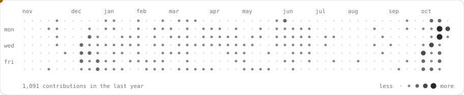

<picture>
  <source media="(prefers-color-scheme: dark)" srcset="assets/card-dark.svg">
  
</picture>

  <a href="https://abhishekdev.online"><b>abhishekdev.online</b></a> ·
  <a href="https://abhishekdev.online/blog">blog</a> ·
  <a href="https://linkedin.com/in/abhishek-chauhan-880496394">linkedin</a> ·
  <a href="mailto:abhichauhan200504@gmail.com">email</a>

Web developer and designer in **Meerut, India**. I design and build websites, web apps and AI tools for businesses, and look after them once they are live.

#### selected work

| project | what it is | live | notes |
|---|---|---|---|
| **ThisBrand** | branding agency website, a Figma design built as a custom WordPress theme | [thisbrand.in](https://thisbrand.in/) | [build notes](https://abhishekdev.online/blog/thisbrand-figma-to-wordpress-theme) |
| **AiSuites** | SaaS marketing site and sign-up flow for an AI platform, WordPress + Tailwind | [aisuites.ai](https://www.aisuites.ai/) | [build notes](https://abhishekdev.online/blog/aisuites-saas-marketing-site-wordpress-tailwind) |
| **OutRight Systems** | CRM company site with Google/Microsoft sign-in and free tools | [outrightsystems.org](https://www.outrightsystems.org/) | [build notes](https://abhishekdev.online/blog/outright-systems-wordpress-oauth-and-free-tools) |
| **This portfolio** | a Three.js road you drive by scrolling, pre-rendered for Google | [abhishekdev.online](https://abhishekdev.online) | [repo](https://github.com/Abh1shxkk/abhishek_portfolio) · [notes](https://abhishekdev.online/blog/how-i-built-this-portfolio-three-js-road) |

More client sites and side projects: [abhishekdev.online/projects](https://abhishekdev.online/projects)

#### last year, one dot per day

<picture>
  <source media="(prefers-color-scheme: dark)" srcset="assets/grid-dark.svg">
  
</picture>

stats rebuild daily via <a href=".github/workflows/build.yml">a workflow</a> · everything here is hand-written svg
